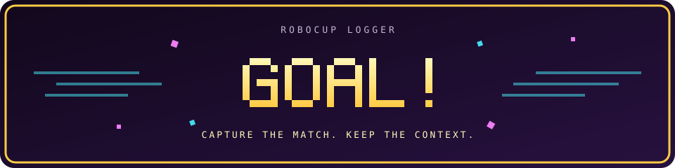

<div align="center">

# RoboCup Logger

**From kickoff to the postgame meeting. All in your terminal.**

Rust · Ratatui · Match logging · Field visualization · Replay



[Get started](#get-started) · [User guide](docs/guide.md) · [Data & networking](docs/guide.md#data--networking)

</div>

## One match, three perspectives

| Live | Replay | Postgame |
| :--- | :--- | :--- |
| Timestamp notes, import GameController events, and watch robot poses and ball estimates. | Revisit the match on a horizontal field with score, clock, event banners, and note-triggered pauses. | Turn observations into tasks with titles, robots, owners, and discussion notes. |

- **Match-aware:** supported-team selection, tracked-team statistics, Golden Goal and official matches.
- **Keep the evidence:** session JSON, generated Markdown, and raw GC/forwarded-robot archives.
- **Stay in control:** correct events, recover from save errors, and explicitly reconnect to a replacement GC.
- **Meeting-ready:** mark actionable notes and open prefilled GitHub issues for manual review and submission.

## Get started

Use a current stable Rust toolchain and a Unicode-capable terminal. A roomy window with true-color support gives the field and banners space to shine.

```sh
cargo build --release
./target/release/robocup-logger
```

Choose **New match**, or **New match from GC** to select your tracked team from a detected match. Review the setup before creating the session.

> Home automatically searches for a GameController on the local network. Robot telemetry is receive-only. GitHub issue tabs use Safari on macOS and currently target `HULKs/hulk`.

## The essentials

| Key | Action |
| :--- | :--- |
| Arrows / HJKL / WASD | Navigate menus |
| Enter / Space | Confirm a menu selection |
| Esc | Back, cancel, or open Actions |
| ? | Contextual help |
| Enter while logging | Timestamp a new note immediately |
| Enter / Esc while writing a live note | Save the note |
| Space during replay | Play, pause, or continue past a note |

Navigation bindings are configurable. Editors accept literal text; Tab is unused.

**Next:** the [short user guide](docs/guide.md) covers replay controls, saved files, recovery, and GitHub handoff.

```text
            .-========-.
         .-'    /\      '-.
        /   ___/  \___     \
       /   /   \  /   \     \
      |   |     \/     |     |
      |    \    /\    /      |
      |     '---  ---'       |
       \    /        \     /
        \   \________/    /
         '-.          .-'
            '-======-'
```

<div align="center"><sub>Keep your eyes on the game. Keep the details in the log.</sub></div>
